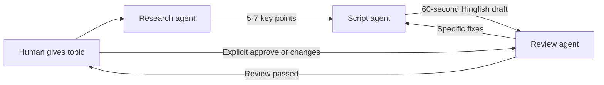

# Content Studio Room

A small Switch hackathon project where three AI agents and a human produce a
60-second Hinglish short-video script together in Discord.

## The workflow



- **research-agent:** returns 5-7 accurate, simple key points.
- **script-agent:** writes a hook, three points, and CTA in Hinglish.
- **review-agent:** checks accuracy, length, tone, and structure.
- **Human:** approves the final script or asks for revisions.

## Repository

- [`switch/content-studio.template.yaml`](./switch/content-studio.template.yaml) -
  official Switch room-and-agent template.
- [`docs/DEMO_SCRIPT.md`](./docs/DEMO_SCRIPT.md) - two-minute recording script.
- [`docs/BLOG.md`](./docs/BLOG.md) - draft blog post.
- [`.env.example`](./.env.example) - records that no API key is required by this template.
- [`.cursor/mcp.json`](./.cursor/mcp.json) - connects Cursor to the Switch docs MCP.

No custom HTTP or SSE server is required. The template uses built-in Claude Code,
Codex, or OpenCode providers managed by Switch Console.

## Validate locally

Ruby is used only for the optional repository check:

```bash
ruby scripts/validate_template.rb
```

## Setup

### Optional: connect the Switch docs MCP in Cursor

The repository includes `.cursor/mcp.json` with the Switch docs MCP configuration.
Restart Cursor after opening the repository, then approve the MCP connection when
Cursor prompts for it.

### Prerequisites

- macOS, Windows, or Linux computer for Switch Console
- Claude Code installed and signed in for the recommended Discord setup
- A Discord account and permission to add/configure a bot
- Docker available only if the local Console setup requests it; let Switch
  Console install and manage its server dependencies

### 1. Clone

```bash
git clone <YOUR_PUBLIC_REPO_URL>
cd <YOUR_REPO_NAME>
```

### 2. Install Switch

1. Install Switch Console and open it.
2. Choose **Run on this computer** and start the local server.
3. Choose Claude Code when configuring Switch's coding-agent provider.
4. Sign in if Console asks for authorization.

If Switch Console's welcome screen offers Switch-buddy, send it one test task
before creating the room. Confirm that it replies and that Console shows the
local server as running.

### 3. Connect Discord

In Switch Console, open the Discord messaging-app setup and follow Console's
wizard. Keep the generated bot token inside Console, Discord Developer Portal,
or environment configuration; never commit it.

The demo needs one Discord channel that can be converted to or used as a
Content Studio room. Discord setup details and required bot permissions should
be taken from Console because they can change between releases.

### 4. Create the room template

1. Open the Switch templates view in Console.
2. Import or select
   [`switch/content-studio.template.yaml`](./switch/content-studio.template.yaml).
3. Enter a team prefix such as `studio`.
4. Choose `claude` as the provider for the recommended setup.
5. Choose Discord/your connected bridge.
6. Confirm creation.

If your Console build does not offer direct file import, paste the template into
the Switch expert or your existing Switch room and ask it to create the agents
and room described by the file. Do not manually rewrite fields that the current
Console rejects.

The created names will be:

- `studio-research`
- `studio-script`
- `studio-review`
- `studio-content-studio` room

### 5. Run the demo

1. Open the Discord room and create a thread.
2. Mention `@studio-research` with a topic.
3. Watch the agent research, address `@studio-script`, and hand off the points.
4. Watch `@studio-script` send the Hinglish draft to `@studio-review`.
5. If the reviewer rejects it, watch it send named fixes back to the script agent.
6. Reply with `Approved` only after the reviewer reports a pass.

Keep the demo on-screen: the visible agent names and hand-offs are the Switch
integration.

## Manual validation

Test these cases before recording:

- Research: ask for a technical topic and verify exactly 5-7 points.
- Script: verify hook, three points, CTA, and approximately 150-160 words.
- Review pass: verify it asks the human to approve explicitly.
- Review fail: request unsupported accuracy or an excessive length and verify
  the review sends numbered fixes to the script agent.
- Human change request: reply in the thread and verify the script agent revises,
  not closes, the task.
- Human approval: reply `Approved` and verify no new revision cycle starts.

## Why Switch is essential

The chat channel is not a transport layer appended after the fact. It is the
shared coordination surface: Discord carries identities, context, threads,
responses, review comments, and human approval. Switch adds stable agent
identities and room instructions, while its agents address one another by name.

That makes the orchestration observable to judges and human participants. The
handoffs stay in one record instead of being hidden across separate API calls,
webhooks, or an external database.
